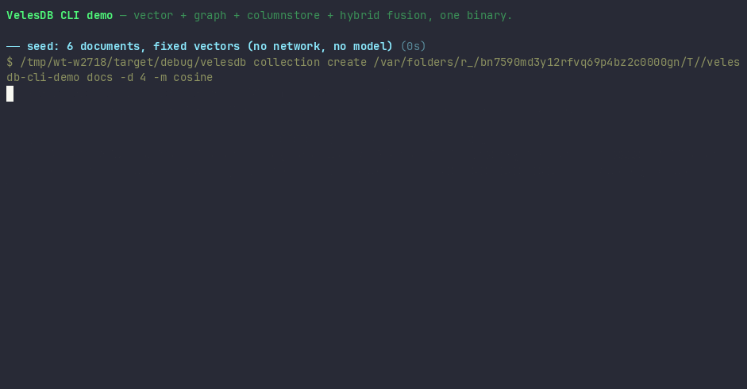

# VelesDB CLI demo

The whole engine in under 3 minutes, one binary, no network, deterministic data.



```bash
cargo build -p velesdb-cli -p velesdb-server   # server binary enables the REST step
bash demos/cli-demo.sh                        # pretty mode: tables + color
bash demos/cli-demo.sh --ci                   # plain output (NO_COLOR)
bash demos/cli-demo.sh --check                # CI smoke: asserts transcript shape
bash demos/cli-demo.sh --db /tmp/x --keep     # custom data dir, kept after the run
```

## Story arc

| Step | Command surface | What it shows |
|------|-----------------|---------------|
| seed | `collection create` + `data upsert` | 6 documents, fixed vectors, no model download |
| ANN + filter | `query execute` `NEAR … AND category = 'tech'` | vector search with a metadata predicate |
| graph | `collection create-graph -d`, `store-payload --vector`, `add-edge`, `traverse`, `graph search` | embedded knowledge graph, BFS, node-vector search |
| columnstore | `GROUP BY category` | aggregation over the same rows |
| fusion | `NEAR + MATCH … USING FUSION(strategy='rrf', k=60)` | each branch alone vs the fused list, side by side — doc 2 is mid-rank in both and tops the fused list |
| EXPLAIN | `query explain` | the real plan: VectorSearch → Filter → Limit, FUSION RRF k=60 |
| REST live | `velesdb-server` + `curl /health` + `POST /query` | same data dir, same engine, over HTTP |
| export | `data export --output-file` | the whole collection back out as JSON |

`cli-demo-expected.txt` is a normalized transcript of a full run (`<DB>`, `<REPO>`,
`<PORT>` and timings scrubbed). `cli-demo.cast` is the asciinema source of the
GIF; re-record with `asciinema rec -c "bash demos/cli-demo.sh --keep" demos/cli-demo.cast`
then `agg demos/cli-demo.cast demos/cli-demo.gif`.

## Why it stays green

The `.github/workflows/cli-demo.yml` job builds `velesdb-cli` + `velesdb-server`
on every change under `demos/cli-demo*` or the two crates, then runs
`cli-demo.sh --check` — ten structural assertions over the transcript
(seed → fusion → EXPLAIN → export). Scores are asserted structurally, never by
exact value, so HNSW ordering noise cannot flake it.
